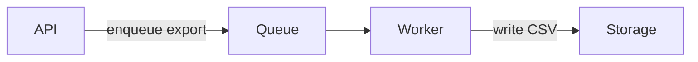

# Pull Request Description

Use this skill whenever you need to write a pull request (PR) description intended for an audience of human reviewers.  

Draft French descriptions with `redaction-francais`, and all other descriptions with `technical-writing-agent`. Then revise with `unslop-agent`. If a required skill is missing, report the missing pass outside the description.

The reviewer knows the ticket's goal and can read the diff, so describe the solution without restating the ticket or the code.

The PR description is an abstraction of the diff. It should be far simpler than the code it describes, useful and honest, and omit unimportant details.  

The reviewer WILL have to operate the code in production.  
**If they deploy this change right now in production, what do they NEED to know?**

Explain the changes in simple terms, using the domain language of the project ("ubiquitous language", .agents/CONTEXT.md, etc.).   
Conciseness is key.  
Each word must earn its place.  
Evaluate every section, paragraph, sentence and word against these criteria, and remove anything that does not meet them all:
1. Appropriate for the intended audience
2. Communicative
3. Minimal

## Presentation

Show, don't tell:

- Logic or an algorithm as pseudocode:

```text
on(save)
  if content is unchanged
    return cached result
  write new content
  return fresh result
```

- Runtime control flow as a call tree:

```text
submitForm
  createSession
    persistPrompt
    launchAgent
  navigateToSession
```

- Show component interaction, control flow, or data flow as a Mermaid diagram when the forge renders Mermaid in pull requests. [GitHub supports this](https://docs.github.com/en/get-started/writing-on-github/working-with-advanced-formatting/creating-diagrams). [Bitbucket Cloud's documented Markdown support](https://support.atlassian.com/bitbucket-cloud/docs/markup-comments/) does not include Mermaid. Otherwise, use a call tree in a text block:



- File responsibility or a broad refactor as a shallow file tree:

```text
src/
├── commands/       # parses user actions
├── sessions/       # owns session state
└── transport/      # sends API requests
```

- Use `diff` when the point is what changes and the surrounding shape already exists. Match the diff shape to the topic.

For a file-layout change:

```diff
 src/
 ├── commands/
+│   └── show-me.ts       # expands the slash command
 ├── sessions/
-└── transport.ts
+└── transport/
+    ├── client.ts
+    └── stream.ts
```

For a state or control-flow change:

```diff
 on(save)
-  write content
+  if content is unchanged
+    return cached result
+  write new content
+  invalidate cache
```

Place each visual next to the short text it supports.

Only use tables for structured data, such as benchmarks.  
If you made significant changes to the UI, include before and after screenshots if you can.  
Headings are fine. Too many headings and/or too many levels of headings are bad.  

